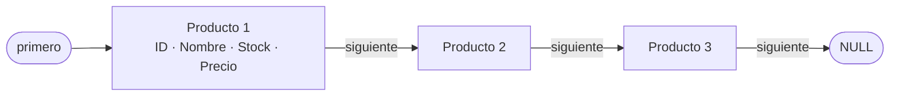

<div align="center">

# 📦 Sistema de Gestión de Inventario en C++

**Inventario de productos implementado con listas simplemente enlazadas y apuntadores**


Proyecto final de **Algoritmos y Estructuras de Datos** — Universidad de Guanajuato, División de Ingenierías (Campus Irapuato‑Salamanca)

</div>

---

## 🎥 Video explicativo

Explicación completa del código, función por función:

[](https://www.youtube.com/watch?v=bmIBiQ_jZgg)

---

## 📋 Descripción

Sistema de consola para administrar el inventario de una tienda. Cada producto se guarda como un **nodo** de una lista simplemente enlazada, por lo que el inventario crece o se reduce dinámicamente en memoria sin un tamaño fijo.

Cada nodo almacena:

| Campo        | Tipo     | Ejemplo        |
|--------------|----------|----------------|
| `ID`         | `int`    | `1054815`      |
| `Nombre`     | `string` | `Agua Epura`   |
| `Cant_Stock` | `int`    | `50`           |
| `Precio`     | `double` | `15.20`        |

## ✨ Funcionalidades

| # | Opción del menú | Qué hace |
|---|-----------------|----------|
| 1 | Agregar producto | Inserta un nuevo nodo al inicio de la lista |
| 2 | Eliminar producto | Busca por ID y desenlaza el nodo, liberando su memoria |
| 3 | Modificar producto | Suma/resta stock (`-5` resta, `5` suma) y actualiza el precio |
| 4 | Mostrar ordenados | Lista los productos por cantidad en stock (descendente) usando una copia temporal |
| 5 | Buscar por ID | Devuelve un apuntador al producto, sin copiarlo |
| 6 | Verificar stock bajo | Muestra los productos por debajo de un límite que indique el usuario |
| 7 | Guardar datos | Exporta el inventario a `Inventario.csv` (abre en Excel) |
| 8 | Limpiar pantalla | — |
| 0 | Salir | Libera toda la memoria de la lista |

## 🧠 Estructura de datos



```cpp
class Producto {
public:
    int ID;
    string Nombre;
    int Cant_Stock;
    double Precio;

    Producto *siguiente;
    Producto(int ID, string Nombre, int Cant_Stock, double Precio)
        : ID(ID), Nombre(Nombre), Cant_Stock(Cant_Stock), Precio(Precio), siguiente(NULL) {}
};
```

La clase `Inventario` guarda un apuntador `primero` al inicio de la lista y expone las operaciones del menú (`agregarProducto`, `eliminarProducto`, `modificarProducto`, `buscarProducto`, `mostrarOrdenadosPorCantidad`, `verificarBajoStock`, `guardarEnCSV`). Su destructor recorre la lista y libera cada nodo.

## 📁 Estructura del repositorio

```
Inventario/
├── src/
│   └── Sistema_De_Gestion_De_Inventarios.cpp   # Código fuente
├── docs/
│   └── Reporte_Proyecto_Final_Inventario.pdf   # Reporte con la explicación del código
└── README.md
```

## ⚙️ Cómo compilar y ejecutar

Necesitas un compilador de C++. Opciones:

- **[Dev‑C++](https://sourceforge.net/projects/orwelldevcpp/)** — abre el `.cpp` y presiona *Compilar y ejecutar*.
- **[Visual Studio Code](https://code.visualstudio.com/)** + **[MinGW‑w64](https://www.mingw-w64.org/)** — desde la terminal:

```bash
g++ src/Sistema_De_Gestion_De_Inventarios.cpp -o Inventario.exe
./Inventario.exe
```

> **Nota:** el programa usa `system("cls")`, `system("pause")` y `system("color")`, que son comandos de Windows.

## 💾 ¿Por qué se pierden los datos al cerrar?

Los productos viven en memoria dinámica (RAM) mediante apuntadores; al cerrar el programa esa memoria se libera. Por eso existe la opción **7 – Guardar datos**, que exporta todo a `Inventario.csv` en la misma carpeta del ejecutable.

## 📄 Documentación

El reporte completo con la explicación de cada clase y función está en [`docs/Reporte_Proyecto_Final_Inventario.pdf`](docs/Reporte_Proyecto_Final_Inventario.pdf).

---

<div align="center">

Hecho por **Erick Isaac Guzmán Paniagua**

</div>
